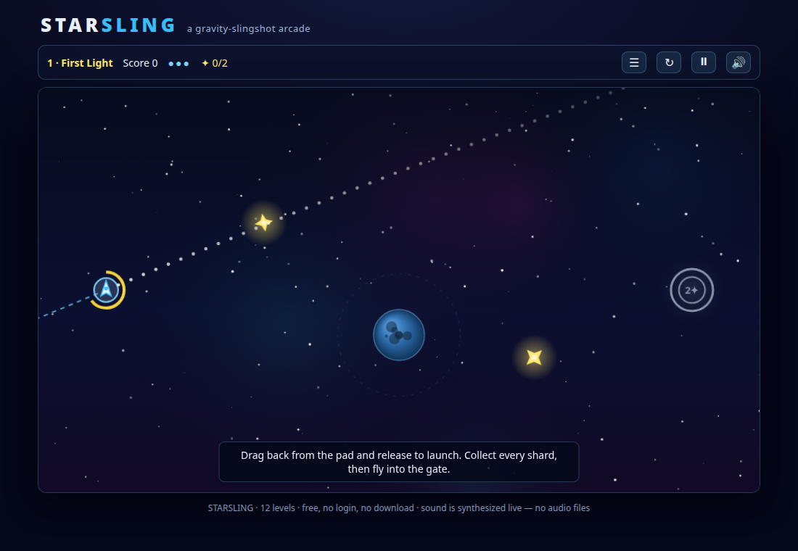
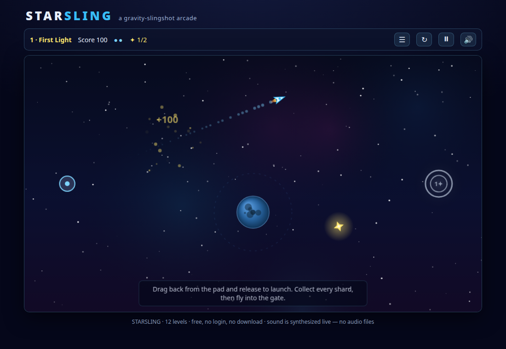

# STARSLING — Gravity Slingshot Arcade

**Entry for [The $65K Web Game Contest](https://nitropay.com/base44webgame/)
(Base44 x Nitro by Overwolf) — $65,000 in cash prizes.**

Slingshot a probe around gravity wells: drag back, release, bend your flight
around planets, collect every star shard, and dive through the gate.
12 hand-designed levels, combo scoring, a Perfect Orbit bonus, drifting
asteroids, synthesized sound — free, no login, no download.

- **Play the reference demo:** TODO — demo URL (Vercel) after deploy
- **Contest deadline:** 3 Dec 2026, 23:59 UTC (4 Dec 2026, 06:59 WIB)
- **The submission** is the Base44 build at a `*.base44.app` URL (see below)




## What this repo is (read this first)

This repo holds a **reference implementation** of STARSLING — a complete,
tested, playable game in zero-dependency HTML/CSS/JS — plus the exact
prompt pack to rebuild it **inside Base44**, which is what the contest
requires (T&C §5.1, §6.1(b): the game must be built with Base44 and hosted
on a Base44 URL). The Base44 build is the submission; this repo proves the
design is fun, complete and winnable, and gives the builder a precise spec
to replicate via prompts.

| File | What it is |
|---|---|
| `game/` | Reference game (playable). `index.html` + `js/` + `css/`. Zero dependencies. |
| `tests/` | Node test suite — 41 tests, all passing (see below). |
| `scripts/smoke_test.py` | Headless Playwright smoke test (real drag-launch, 0 console errors). |
| `DESIGN.md` | Full game design document (mechanics, numbers, levels, art/audio direction). |
| `BASE44_PROMPTS.md` | **The main deliverable:** ordered, paste-ready Base44 prompts + free-plan credit budget. |
| `SUBMISSION.md` | Draft submission (title, description, how-to-play) + eligibility checklist. |
| `VIDEO_SCRIPT.md` | Demo video script (< 3 min, no face). |
| `SUBMIT_STEPS.md` | Step-by-step instructions for the entrant (Bahasa Indonesia). |
| `screenshots/` | Screenshots from the smoke test. |

## Play locally

```bash
# any static server works; the game is just files under game/
npx -y serve game -l 3000
# or: python3 -m http.server 3000 -d game
```

Then open http://localhost:3000. Drag anywhere to aim, release to launch.
Keys: `R` restart, `P` pause, `M` mute.

## Tests

```bash
npm test
```

**41/41 pass** (~30 s). Coverage:

- **Physics** (16): slingshot mapping, gravity, straight-line flight, speed
  cap, planet/asteroid crash, shard collection, locked/unlocked gate,
  out-of-bounds, timeout, orbit detection (a real circular orbit triggers
  the bonus), determinism.
- **Scoring** (8): combo chaining/window/cap, shard points, completion
  bonus, star thresholds.
- **Levels** (4): 12 levels, unique names, structural validation of every
  level (bounds, overlaps, budgets), validator catches bad data.
- **Game state machine** (12): menu/playing/complete/game-over transitions,
  launch consumption, crash/lost/game-over flows, aim preview, full
  playthroughs of levels 1 and 6 through the real game loop, restart,
  campaign score.
- **Solvability** (1): a greedy automated solver (angle × power grid +
  refinement, mimicking a human using the aim preview) **beats all 12
  levels within their launch budgets** — the proof the game is winnable.
  Star thresholds are set from the solver's scores.

```bash
# Headless browser smoke test (needs the Playwright venv + chromium):
~/workspace/airdrop-agent/.venv/bin/python scripts/smoke_test.py
```

## Game at a glance

| | |
|---|---|
| Genre | Physics arcade / slingshot puzzle |
| Levels | 12, hand-designed, progressive (1 planet → 4 planets + asteroids) |
| Core mechanic | Drag-back slingshot launch + real gravity; live dotted trajectory preview using the same physics as the flight |
| Scoring | Shards 100 × combo (x1–x5, 2.5 s window) · Perfect Orbit +250 · completion 500 + 150/unused launch + time bonus ≤300 · 1–3 stars per level |
| Hazards | Planets (crash), drifting asteroids (crash), off-screen (lost), 25 s flight timer |
| Tech | Zero dependencies. Canvas + DOM. Fixed 1/120 s physics substeps. WebAudio-synthesized SFX (no audio files). All art procedural (no image assets, no third-party IP). Progress in localStorage. |

## Honest caveats

- **The Base44 build does not exist yet.** It is built by the entrant via
  the prompts in `BASE44_PROMPTS.md` (the builder has no Base44 account
  and no live browser). Until it is published, there is no submittable
  game — only this reference.
- **The contest submission form's exact fields were not verified** (they
  need a browser session). `SUBMISSION.md` follows T&C §5.1(c)'s field
  list; verify against the live form when submitting.
- **Base44 free-plan figures** (25 message credits/month, max 5/day, 100
  integration credits, 5 apps) were verified 19 Nov 2026 from Base44's
  pricing guides and independent reviews checked Nov 2026 — re-check on
  the Base44 dashboard at signup, as plans change.
- **Balance was validated by an automated solver**, not by human
  playtesting at scale. The solver beats every level; human difficulty
  may still need a nudge (the fix prompts in `BASE44_PROMPTS.md` §5 cover
  this).
- **No real-device testing** beyond a headless Chromium smoke test
  (desktop viewport + simulated touch drag). Test on a real phone after
  publishing.

## Sources (verified 19 Nov 2026)

- Contest page: https://nitropay.com/base44webgame/ (prizes, timeline,
  how to enter, FAQ)
- Terms & Conditions: https://nitropay.com/base44webgame/terms-and-conditions/
  (§3 dates, §4.1 free account, §5.1–5.2 one submission, §6.1 requirements,
  §8 judging/community, §9 prizes, §9.4/§10.1 winner verification)
- Base44 pricing: https://base44.com/guides/how-much-does-base44-cost
  (Free: 25 message credits/month, max 5/day)

## License

MIT — see `LICENSE`.
